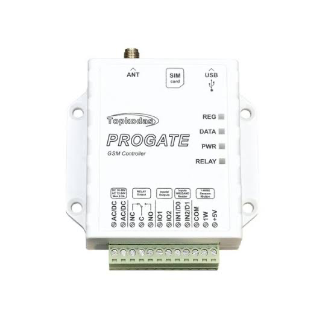

# Topkodas PROGATE (SERANOVA) — Home Assistant integration

[](https://my.home-assistant.io/redirect/marketplace_repository/?owner=jut-a&repository=ha-seranova-gate&category=integration)
[](https://my.home-assistant.io/redirect/config_flow_start/?domain=seranova_gate)

Unofficial Home Assistant integration for the **Topkodas PROGATE** GSM gate controller.
Open a sliding or swing gate, barrier or garage door from Home Assistant dashboards,
automations or voice, through the **SERANOVA** cloud (the same cloud the SERANOVA app and
[seranova.eu](https://seranova.eu) use). No SMS, no phone call, no SMS costs. See who
opened the gate and when.

Also known as: the PROGATE "GSM Controller" (front label), configured with SERA2,
controlled with the SERANOVA app. Works with the default SERA Cloud Service
(`cloud.topkodas.lt`).

**Lietuviškai:** neoficiali Home Assistant integracija Topkodas PROGATE GSM vartų
valdikliui. Stumdomus ar varstomus vartus, užkardą (šlagbaumą) ar garažo vartus galite
atidaryti iš Home Assistant per SERANOVA debesį, be SMS ir be skambučio, ir matyti,
kas ir kada atidarė vartus.

<p align="center">
  <br>
  <sub>Topkodas PROGATE. Product photo: Topkodas.</sub>
</p>

> **Unofficial.** Not affiliated with or endorsed by UAB Topkodas. The cloud protocol was
> decoded from the public SERANOVA web app and can change without notice. You use this
> to control a physical gate — test it while watching the gate.

## Features

- UI setup: sign in with your SERANOVA e-mail and password, pick your system, enter the
  App Key and user code (checked against the device before the entry is created).
- **Persistent cloud connection** with automatic reconnect and token refresh. While the
  gate controller cannot be reached, the integration shows as *Retrying setup* with the
  reason, like other integrations whose device is offline.
- **Button per output** (up to 4) that pulses the output for a configurable number of seconds.
- **Online** connectivity sensor (cloud connected and the device answering).
- **Event entity** for everything the device reports (access granted / denied, alarms,
  troubles, restores, tests), decoded into readable fields such as
  `message: "Access Gained by John (User 1)"`. Also fired as the `seranova_gate_event` bus event.
- **Last event** and **Last event time** sensors.
- **Event log** kept outside the recorder, so it is never purged (forever by default, or for
  a number of days), read with the `seranova_gate.get_events` action.
- `seranova_gate.open` action with an optional response, so automations can fall back to
  SMS or a phone call **only when it is safe** (see below).
- No extra Python requirements.

## Requirements

- A PROGATE with **SERA Cloud Service enabled** and a SIM with mobile data (the device must
  show as online in the SERANOVA app).
- A SERANOVA account that signs in with **e-mail and password**. Google / Apple sign-in and
  two-factor authentication are not supported.
- Home Assistant 2025.8 or newer (tested on 2026.11).
- Access events must be reported by the device (the default): an open counts as successful
  only when the PROGATE reports "Access Gained" (Contact ID 422).

### Tested with

- A PROGATE, firmware `052502131936` (boot `PROGATEv2_boot_v2`, as the device reports it).
- **OUT1** (the RELAY output) wired to the gate motor controller's **step-by-step input**
  (open → stop → close), 2 s pulse (the default). How the gate reacts to each pulse depends on the motor controller,
  not on the PROGATE.
- Checked live with 0.2.3: a press opens the gate (confirmed about 3 s after the press); a
  second press after the confirmation stops it, the next one closes it; a press after a quiet
  spell opens on the first state request.
- Not tested: outputs 2–4, other PROGATE models or firmware, wiring to an "open only" input.

## Installation

### Marketplace (Home Assistant 2026.11 and newer)

[](https://my.home-assistant.io/redirect/marketplace_repository/?owner=jut-a&repository=ha-seranova-gate&category=integration)

Or by hand: **Settings → Marketplace → Add from link** →
`https://github.com/jut-a/ha-seranova-gate`, then install **Seranova Gate (Topkodas PROGATE)**.
The setup starts right after the install; updates later need a restart.

### HACS (Home Assistant before 2026.11)

[](https://my.home-assistant.io/redirect/hacs_repository/?owner=jut-a&repository=ha-seranova-gate&category=integration)

Or by hand: HACS → ⋮ → **Custom repositories** → add
`https://github.com/jut-a/ha-seranova-gate`, category **Integration**, install
**Seranova Gate (Topkodas PROGATE)** and restart Home Assistant.

### Manual

Copy `custom_components/seranova_gate` into your Home Assistant `config/custom_components/`
folder and restart Home Assistant.

## Configuration

[](https://my.home-assistant.io/redirect/config_flow_start/?domain=seranova_gate)

Or: Settings → Devices & services → **Add integration** → *Seranova Gate*.

| Step | What to enter |
| --- | --- |
| Sign in | SERANOVA e-mail and password |
| System | Pick the system from your account (or type the IMEI) |
| Access codes | **App Key**: the device's SERA Cloud Service key, the same as in the SERANOVA app (factory default `123456`). **User code**: your **user access code** (SERA2 → Users/Access → Users; factory default `1234` or `123456`), the one the SERANOVA app asks for — **not** the SMS user password. |

The user access code is what protects opening the gate through the cloud: if yours is still
the factory default, change it in SERA2. Changing the App Key is a different matter: changing
it with SMS command `009` (and in the SERANOVA app) took the device offline in testing until
both were set back to `123456` — see [docs/SMS.md](docs/SMS.md).

**Options** (⚙ on the integration): enable/name up to four outputs and set each pulse length
(default: output 1 "Gate", 2 s), the status poll interval (default 10 min, `0` = off), the
**minimum time between pulses** (default 30 s, `0` = off; see Safety) and how many days the
**event log** keeps events (default `0` = forever).
**Reconfigure** changes the login, the codes or the name; if the password stops working,
Home Assistant asks you to sign in again.

## Entities

| Entity | Description |
| --- | --- |
| `button.<system>_<output>` | Pulses the output. Raises an error if the device did not confirm it. |
| `binary_sensor.<system>_online` | Connectivity: on when the device itself answered the last state request (each poll and before every pulse) or sent an event; the cloud's quick replies do not count. Holds its state through a short reconnect. Attributes: `last_seen` (last frame from the device), `last_error`. |
| `sensor.<system>_last_event` | Text of the last device event, e.g. `Access Gained by John (User 1)`; shows in the logbook and history, restored after a restart. Attributes: `event_type`, `subject`, `user_or_zone`, `code`, `device_time`. |
| `sensor.<system>_last_event_time` | When the last device event happened, by the gate controller's own clock (timestamp: dashboards show "3 minutes ago"); restored after a restart. |
| `event.<system>_event` | Last device event. Types: `access_granted`, `access_denied`, `alarm`, `trouble`, `restore`, `test`, `event`. Attributes: `message`, `subject`, `subject_detail`, `user_or_zone`, `partition`, `description`, `object`, `code`, `cid`, `device_time`, `text`. |

## The `seranova_gate.open` action

```yaml
action: seranova_gate.open
data:
  output: 1      # optional, default 1
  seconds: 2     # optional, default = the output's configured pulse length
response_variable: gate
```

The response is `{success, stage, error, fallback_safe, acked, confirmed_by}`. `stage` is
`locked` (refused by the minimum time between pulses), `connect` (no cloud connection, or the
cloud did not respond), `wake` (the device did not answer the state request sent before every
pulse) or `open` (the output command itself). `success` is `true` only when the gate itself reported
the access (`confirmed_by: access_event`); `acked` only says the cloud accepted the command,
which is **not** proof that the gate got it. **`fallback_safe` is `true` only when the output
command never reached the device.** If the command was sent but not confirmed, the gate may
still move — sending another pulse (by SMS, call or a retry) can stop or reverse it.

Example: open from the cloud, fall back to an SMS only when that cannot double-trigger:

```yaml
- action: seranova_gate.open
  response_variable: gate
- if: "{{ not gate.success and gate.fallback_safe }}"
  then:
    - action: notify.my_sms_gateway   # your SMS service; message format: USER<code> 022 1#2#
      data:
        message: "USER123456 022 1#2#"
```

The SMS must come from a phone number in the device's user list. All SMS commands (outputs,
status requests, users, cloud settings): [docs/SMS.md](docs/SMS.md).

Example: notify on every access:

```yaml
triggers:
  - trigger: state
    entity_id: event.my_gate_event
    attribute: event_type
conditions:
  - condition: template
    value_template: "{{ trigger.to_state.attributes.event_type == 'access_granted' }}"
actions:
  - action: notify.notify
    data:
      message: "{{ trigger.to_state.attributes.message }}"
```

### Example: open the gate when arriving by car

Uses the Home Assistant Companion app on the phone: a `person` entering the home zone, and that
phone's activity sensor saying the person is driving (iOS: `sensor.<phone>_activity` =
`Automotive`; Android: `sensor.<phone>_detected_activity` = `in_vehicle`). Someone walking or
cycling home does not open the gate. Make the home zone large enough that the gate has time to
open before the car gets there: the cloud path takes about 3 s on top of the gate's own travel
time.

One person:

```yaml
alias: Open the gate when arriving by car
mode: single
triggers:
  - trigger: zone
    entity_id: person.john
    zone: zone.home
    event: enter
conditions:
  - condition: state
    entity_id: sensor.johns_phone_activity
    state: Automotive
actions:
  - action: seranova_gate.open
    response_variable: gate
```

Two people:

```yaml
alias: Open the gate when arriving by car
mode: single
triggers:
  - trigger: zone
    entity_id: person.john
    zone: zone.home
    event: enter
    id: john
  - trigger: zone
    entity_id: person.jane
    zone: zone.home
    event: enter
    id: jane
conditions:
  # Only the person who arrived, and only if their phone says they are driving.
  - condition: or
    conditions:
      - condition: and
        conditions:
          - condition: trigger
            id: john
          - condition: state
            entity_id: sensor.johns_phone_activity
            state: Automotive
      - condition: and
        conditions:
          - condition: trigger
            id: jane
          - condition: state
            entity_id: sensor.janes_phone_activity
            state: Automotive
  # Both in the same car: the second phone enters the zone seconds to a minute later.
  # Open only once in 2 minutes. Keep this condition after the driving check, so that
  # someone walking home does not start the 2 minutes.
  - condition: template
    value_template: >
      {{ this.attributes.last_triggered is none
         or now() - this.attributes.last_triggered > timedelta(minutes=2) }}
actions:
  - action: seranova_gate.open
    response_variable: gate
```

**Keep the 2-minute condition.** Once the gate has confirmed a pulse, the integration accepts a
new press 5 s later (so you can stop or close the gate yourself), and the second phone's
arrival would be such a press: on an open → stop → close input it would stop the opening gate.

To fall back to an SMS when the cloud cannot be used, add the `if:` step from the example
above after `seranova_gate.open`. Use `seranova_gate.open` rather than pressing the button: the
action returns its result instead of failing the automation.

## The event log and `seranova_gate.get_events`

Every event the gate controller reports is also written to the integration's own event log,
in Home Assistant's storage (`.storage/seranova_gate.<IMEI>.events`, part of every backup).
The recorder does not touch it, so it is not purged after `purge_keep_days`. It keeps events
for the number of days set in the options; the default `0` keeps them forever. Each event
takes about 300 bytes, so a home gate with 5–20 events a day adds roughly 0.5–2 MB a year; the
file is rewritten at most every 2 s while events arrive. Set the days option if your site is
much busier. It belongs to the device, not the config entry: removing and adding the
integration again keeps it.

```yaml
action: seranova_gate.get_events
data:
  since: "2026-11-01 00:00:00"   # optional; local time unless it carries a time zone
  until: "2026-11-07 23:59:59"   # optional
  event_type: access_granted     # optional
  limit: 50                      # optional, default 100, newest first
response_variable: log
```

Response (newest first):

```yaml
events:
  - time: "2026-11-07T09:13:11+00:00"       # the gate controller's clock
    received: "2026-11-07T09:13:13.118+00:00"
    type: access_granted
    message: Access Gained by John (User 1)
    subject: John
    subject_detail: User 1
    user_or_zone: 1
    partition: 0
    code: "422"
    cid: "142200001"
    device_time: "2026-11-07T09:13:11+00:00"
count: 1      # entries returned
logged: 412   # entries in the log
```

Events the device sent while Home Assistant was not connected to the cloud are missing (the
cloud does not replay them); the event log in the SERANOVA app / SERA2 is the complete record.
The log holds names and phone numbers as the device reports them, so it is left out of the
diagnostics (only its size is there).

## Safety

Many gate motors take the PROGATE pulse on an **open → stop → close** input, so every extra
pulse stops or reverses the gate. The integration therefore:

- sends nothing that can switch an output until the **device itself has answered a state
  request** — the cloud accepts commands for a device that is not listening, and they are lost;
- sends the output command **exactly once** — the device does not de-duplicate a re-sent
  command, so a retry would pulse the gate again; only the harmless state request and
  "prepare" step are retried;
- reports **success only when the gate itself reports the access** — the cloud acknowledges a
  command within a fraction of a second even when the device never receives it;
- never reuses a frame sequence number (SEQ), also across restarts — reusing one made the
  device skip a command, or run it several times;
- refuses a new pulse for the **minimum time between pulses** (default 30 s) after the last
  pulse or after any access the device reported (app, SMS, key fob). One exception, so the gate
  can be stopped or closed from Home Assistant: once the device has confirmed a pulse with its
  access event, a **new** press made after that event is allowed 5 s after it. A double tap or
  a press queued before the confirmation still waits the full time, and so does a press after
  any other access event.

If your PROGATE relay is wired to an "open only" input, extra pulses are harmless and you can
set the minimum time to `0`. Details in [docs/PROTOCOL.md](docs/PROTOCOL.md).

## FAQ

### Can I open a PROGATE gate from Home Assistant without SMS?

Yes. The integration sends the same command the SERANOVA app sends, through the SERANOVA
cloud, so no SMS or call is made and nothing is charged per opening. The PROGATE needs SERA
Cloud Service on and a SIM with mobile data; an SMS-only setup is not supported.

### Does it work with the SERANOVA app at the same time?

Yes. Both use the same cloud and the same account, and every access the PROGATE reports
shows up in Home Assistant, whoever made it. Keep the App Key the same in the app, on the
device and in Home Assistant.

### Can Home Assistant open the gate automatically when I arrive by car?

Yes, with an automation on your phone's location and driving activity. See
[Example: open the gate when arriving by car](#example-open-the-gate-when-arriving-by-car).

### Does it need a local connection or extra hardware?

No. Nothing beyond the PROGATE itself: it talks to the cloud over its own SIM, and Home
Assistant only needs internet access. If the cloud is down, calls and SMS to the PROGATE
keep working.

### Can I see who opened the gate?

Yes. Every access the PROGATE reports arrives as an event (for example
`Access Gained by John (User 1)`) and is kept in the integration's event log.

## Troubleshooting

| Symptom | What to check |
| --- | --- |
| **Online is off** | The device in the SERANOVA app: the SIM needs mobile data and SERA Cloud Service must be on. The device keeps its cloud link alive with a ping every `PING` seconds (default 600). |
| **"did not answer a state request"** (stage `wake`) | Before every pulse the integration asks the device for its state and waits about 20 s for its own answer; none came, so nothing was sent to the gate and an SMS fallback is safe. Same checks as *Online is off*; the diagnostics' `recent_state_checks` show how long the device usually takes to answer. |
| **"the gate did not confirm it"** | The cloud accepted the command but the device never reported the access. Check the SERANOVA event log: no entry means the device never got it; a late entry means a slow mobile link. |
| **"the gate was operated moments ago"** | The minimum time between pulses (Options) refused a second pulse. Set it to `0` only if your gate input is "open only". |
| **Integration shows *Retrying setup* / failed** | The setup only completes when the gate controller answers a state request. The reason is shown on the integration: *the SERANOVA cloud reports the gate controller offline* or *keeps closing the session* (the device is not connected to the cloud: check it in the SERANOVA app, its SIM data and SERA Cloud Service), *did not answer a state request*, *cannot reach the SERANOVA cloud*, or a rejected App Key / user code (use *Reconfigure*). Home Assistant retries on its own (after 5, 10, 20, 40 s, then every 80 s) and logs it. A running integration that loses the device the same way (3 sessions cut short, 3 failed connects, or 2 unanswered state checks in a row) logs a warning and goes back to *Retrying setup*. Calls and SMS to the PROGATE keep working meanwhile. |
| **Wrong App Key / user code** | Use *Reconfigure*. |

### Reporting a problem

1. **Enable debug logging**: Settings → Devices & services → *Seranova Gate* → ⋮ →
   *Enable debug logging*.
2. Reproduce the problem (e.g. press the button once).
3. ⋮ → *Disable debug logging*: Home Assistant downloads the log.
4. Device page → ⋮ → **Download diagnostics**. It holds the connection state, counters, the
   last 20 commands (with timings: cloud ack, gate confirmation), the last 20 device events
   and the last 20 cloud disconnects.
5. Open an [issue](https://github.com/jut-a/ha-seranova-gate/issues/new/choose) and attach
   both files, plus what you saw at the gate.

Both are designed to leave out personal data: the debug log only names frame types,
sequence numbers and timings, and diagnostics redact the IMEI, SIM number, App Key, codes,
e-mail and every name. Still read them once before posting.

## License

[MIT](LICENSE)
